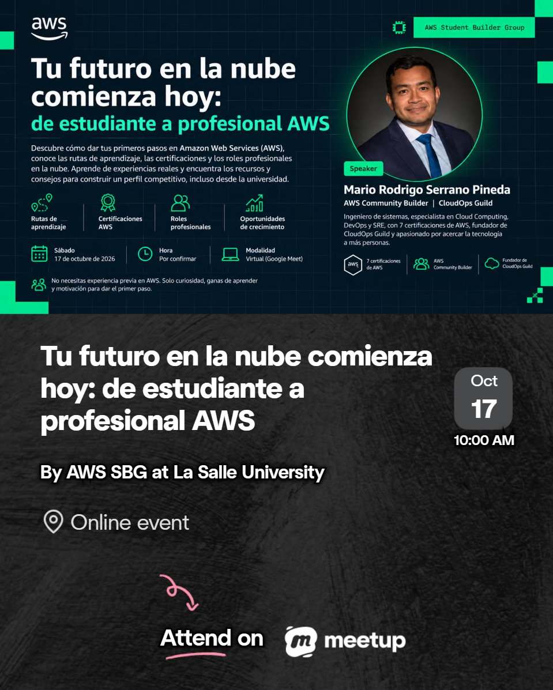

<div align="center">

# ☁️ Tu futuro en la nube comienza hoy
### De estudiante a profesional AWS



**AWS Student Builder Group · Universidad de La Salle · CloudOps Guild**

**Charla virtual | 17 de octubre de 2026**

*Una guía para descubrir tu ruta, aprender con propósito y construir experiencia real en AWS.*

[📑 Presentación](#-presentación-de-la-charla) · [🧭 Rutas cloud](#-elige-tu-ruta-profesional) · [🚀 Plan de 90 días](#-tu-plan-de-90-días) · [🎓 Starter Kit](#-aws-cloud-career-starter-kit) · [🔗 Comunidad](#-sigamos-aprendiendo)

</div>

---

## 👋 Bienvenido/a

¿Te interesa **cloud computing**, pero no sabes por dónde comenzar? ¿Qué deberías aprender primero? ¿Qué certificación elegir? ¿Qué hace un arquitecto cloud, un desarrollador o un ingeniero DevOps/SRE?

Este repositorio reúne los recursos de la charla **«Tu futuro en la nube comienza hoy: de estudiante a profesional AWS»**, compartida con el **AWS Student Builder Group de la Universidad de La Salle**.

El objetivo no es memorizar servicios ni acumular certificaciones: es ayudarte a **encontrar un camino profesional, construir fundamentos y demostrar tus habilidades con proyectos**.

> **No esperes a que llegue una oportunidad para comenzar a prepararte. Prepárate para cuando esa oportunidad llegue.**

## 🎯 ¿Qué aprenderás?

- Identificar las principales **oportunidades profesionales** en el ecosistema AWS.
- Explorar **rutas de aprendizaje y certificación** según tus intereses.
- Comprender cómo combinar **estudio, práctica, proyectos y comunidad**.
- Conocer recursos para empezar, incluso **sin experiencia previa**.
- Diseñar un **plan de acción de 90 días** para tu primer proyecto cloud.

## 📑 Presentación de la charla

La presentación incluye mi recorrido profesional, un mapa de roles cloud, certificaciones por especialidad, ejemplos de arquitectura, recursos y un plan de aprendizaje.

📥 **[Descargar diapositivas en PDF](./aws_student_lasalle_slides_v4.pdf)**

## 🧭 Elige tu ruta profesional

| Ruta | ¿Qué te gustaría hacer? | Habilidades que puedes explorar |
|---|---|---|
| 🏗️ **Arquitectura cloud** | Diseñar soluciones seguras, escalables y resilientes | Redes, cómputo, almacenamiento, bases de datos, arquitectura |
| 💻 **Desarrollo cloud** | Construir aplicaciones y APIs | Programación, APIs, Lambda, DynamoDB, CI/CD |
| ⚙️ **DevOps / SRE** | Automatizar entregas y mejorar la confiabilidad | Linux, Git, IaC, observabilidad, pipelines, operación |
| 🔐 **Seguridad cloud** | Proteger identidades, datos e infraestructura | IAM, cifrado, redes, auditoría, seguridad por diseño |
| 📊 **Datos** | Construir soluciones de procesamiento y análisis | SQL, almacenamiento, pipelines, analítica |
| 🤖 **IA / ML** | Crear soluciones inteligentes | Python, datos, fundamentos ML, servicios de IA generativa |

**No tienes que aprender todas las rutas.** Elige una que te interese y empieza con proyectos pequeños.

## 🏅 ¿Por dónde comenzar con las certificaciones?

Mi recomendación personal es estudiar los contenidos de **AWS Certified Solutions Architect – Associate** como **base técnica transversal**, incluso si después eliges desarrollo, DevOps, seguridad, datos o IA.

¿Por qué? Porque te ayuda a conectar los fundamentos de **redes, cómputo, almacenamiento, seguridad, resiliencia y costos** con decisiones de arquitectura.

Una progresión orientativa:

```text
Fundamentos de nube y AWS
          ↓
Solutions Architect – Associate (base recomendada)
          ↓
Especialización según tu rol
          ↓
Proyectos prácticos + certificaciones avanzadas
```

**AWS Certified Cloud Practitioner es opcional** como introducción. Ni Cloud Practitioner ni Solutions Architect – Associate son requisitos universales para todos los roles o exámenes. Puedes estudiar sus contenidos y adaptar el orden a tu experiencia.

Algunas certificaciones de especialización que puedes investigar según tu objetivo: **Developer – Associate**, **CloudOps Engineer – Associate**, **Data Engineer – Associate**, **Machine Learning Engineer – Associate**, **Security – Specialty**, **Solutions Architect – Professional** y **DevOps Engineer – Professional**. Consulta siempre las páginas oficiales para comprobar la oferta y requisitos vigentes.

🔗 [AWS Certification](https://aws.amazon.com/certification/)

## 🚀 Tu plan de 90 días

| Etapa | Semanas | Objetivo | Entregable |
|---|---|---|---|
| **1. Fundamentos** | 1–4 | Conceptos cloud, IAM, redes, costos y servicios básicos | Notas, diagramas y cuenta de laboratorio protegida |
| **2. Construcción** | 5–8 | Crear y documentar un proyecto pequeño en AWS | Repositorio GitHub con código y arquitectura |
| **3. Especialización** | 9–12 | Mejorar el proyecto según tu ruta y compartir lo aprendido | README técnico, evidencias y retrospectiva |

**Primer proyecto sugerido:** un portafolio web estático con **Amazon S3 privado + Amazon CloudFront (Origin Access Control)**. Documenta el diseño, los controles de seguridad, el costo estimado y cómo eliminar los recursos al terminar.

> ⚠️ **Costos y seguridad:** revisa los precios y las condiciones de capa gratuita antes de desplegar. Configura AWS Budgets y alertas; **una alerta de presupuesto no detiene automáticamente los cargos**. Nunca publiques claves de acceso ni credenciales en GitHub.

## 🎓 AWS Cloud Career Starter Kit

Complementa esta charla con el **AWS Cloud Career Starter Kit**, una guía con rutas profesionales, certificaciones orientativas, plan de 90 días y actividades de aprendizaje.

📥 **[Descargar Starter Kit en PDF](./AWS_Cloud_Career_Starter_Kit_2026_V2.pdf)**


## 📚 Recursos gratuitos para seguir aprendiendo

- [AWS Skill Builder](https://skillbuilder.aws/) — cursos y rutas de aprendizaje.
- [AWS Educate](https://aws.amazon.com/education/awseducate/) — recursos para estudiantes y principiantes.
- [AWS Builder Center](https://builder.aws.com/) — artículos y experiencias de builders.
- [AWS Workshops](https://workshops.aws/) — laboratorios y talleres prácticos.
- [Documentación oficial de AWS](https://docs.aws.amazon.com/) — referencia técnica.

## 👨‍💻 Sobre el speaker

**Mario Rodrigo Serrano Pineda**  
AWS Community Builder · CloudOps Guild

Ingeniero de sistemas con experiencia en infraestructura, liderazgo de TI, soporte cloud y DevOps/SRE. Mi recorrido profesional incluye **Administrador de Sistemas e Infraestructura → Coordinador de TI → Jefe de Servicios Tecnológicos → Líder de Soporte Cloud → DevOps/SRE**.

Mi primer acercamiento a AWS surgió al investigar qué habilidades necesitaba aprender para seguir creciendo profesionalmente. Empecé con un curso de **AWS Solutions Architect – Associate** y continué profundizando en arquitectura, automatización, operación y comunidades técnicas.

Entre mis certificaciones destacadas están **AWS Solutions Architect – Professional** y **AWS DevOps Engineer – Professional**.

## 🤝 Sigamos aprendiendo

| Canal | Enlace |
|---|---|
| 🎥 YouTube · CloudOps Guild | [@CloudOpsGuildCommunity](https://www.youtube.com/@CloudOpsGuildCommunity) |
| 🌐 Blog · CloudOps Guild | [cloudopsguild.com/blog](https://cloudopsguild.com/blog/) |
| 💼 LinkedIn · CloudOps Guild | [CloudOps Guild](https://www.linkedin.com/company/cloudopsguild/) |
| 👤 LinkedIn personal | [Mario Rodrigo Serrano Pineda](https://www.linkedin.com/in/mario-rodrigo-serrano-pineda/) |
| 🧑‍💻 GitHub | [marosepi2020](https://github.com/marosepi2020) |
| 🟠 AWS Builder Center | [Artículos del autor](https://builder.aws.com/community/@marosepi2020?tab=articles) |
| ✍️ Medium | [@marioserranopineda](https://medium.com/@marioserranopineda) |
| 📝 DEV Community | [@marosepi2020](https://dev.to/marosepi2020) |

Si este material te ayuda, ⭐ **dale una estrella al repositorio** y compártelo con alguien que esté comenzando en cloud.

---

<div align="center">

**Aprende · Construye · Comparte**

*Mario Rodrigo Serrano Pineda · CloudOps Guild*

<sub>Material educativo independiente para la comunidad. No constituye una publicación oficial ni implica respaldo de Amazon Web Services (AWS) o de la Universidad de La Salle.</sub>

</div>
